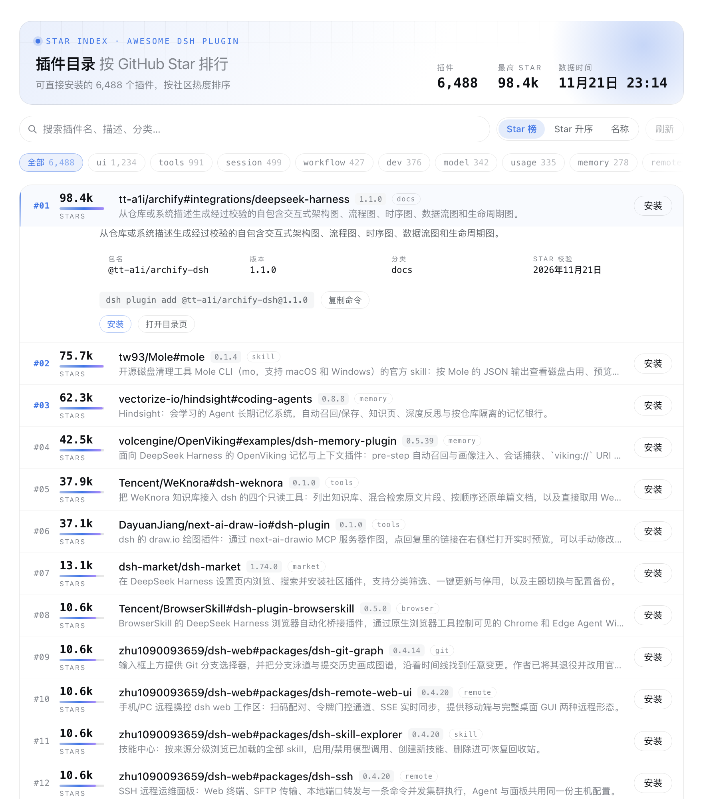
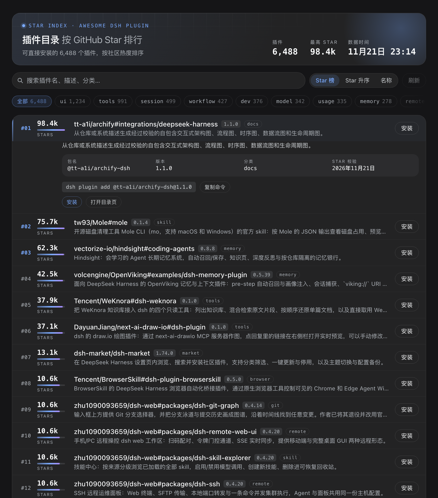

# dsh-awesome-stars · 发现页 Star 版

把 DSH **Plugins → 发现** 升级成带 GitHub Star 的目录页：每个可安装插件都显示 Star 数、按 Star 排序，并保留搜索、分类、安装、详情这些原生能力。它不是一个并列的新标签，而是**接管**原生「发现」这一格，所以 Plugins 页仍然只有一个目录入口。



## 为什么需要它

- 官方市场索引 `https://awesome-dsh-plugin.com/index.json`（format 1）里 `metadata.sortKeys` 是空的，每个插件也没有 Star 数值 —— 所以原生「发现」页无法按 Star 排序，卡片上也没有 Star。
- 目录站自己的 `https://awesome-dsh-plugin.com/plugins.json` 带 `stars` / `starsCheckedAt`（由 GitHub 数据生成）。本插件读取它，投影出 npm 市场能安装的 6,488 条，再交给页面排序和展示。

## 接管方式（为什么不是新标签）

DSH 的 Discover 列表是编译产物，没有卡片级插槽，插件无法往原卡片里塞 Star。可用的机制只有槽位遮蔽：

- 在 `plugins.tab` 里用**相同的 cell id `discover`**、`priority: -10` 注册本页；渲染器按 priority 选举 cell 的 winner，于是原生 Discover 被原地替换（`renderSlot` 走 `entriesOfSlot`，同一格只渲染 winner）。
- 页面构建标签条时用的是原始账本行（`slots.entries`），同格两条记录会显示成两个「发现」。插件在 `ctx.effect` 里只对 `plugins.tab` 过滤掉被替换那一行（按组件身份，不动别的插件），标签条恢复成「已安装 / 发现」两格。
- 代价：原生 Discover 的详情页 / 版本选择器不再显示，改由行内展开面板提供包名、版本、分类、Star 校验时间、`dsh plugin add` 命令、安装按钮和目录页链接。

## 界面

- **头部统计**：可安装插件数、最高 Star、数据时间；网格 + 光晕底纹，深浅色都按 `--dsw-alias-*` token 取色。
- **排序**：`Star 榜`（降序）/ `Star 升序` / `名称`；没有 Star 数据的条目永远排在最后。
- **搜索**：包名、标题、中英文简介、分类。
- **分类 chips**：按目录分类过滤，带计数。
- **列表行**：排名、Star 数（`98.4k`）、对数刻度的 Star 数据条、标题、版本、分类、一行简介、安装按钮。
- **行内展开**：完整简介、包名 / 版本 / 分类 / Star 校验时间、可复制的安装命令、安装、打开目录页。
- **其它**：每页 60 条「加载更多」、手动刷新（强制拉上游）、缓存过期提示、骨架屏、错误重试。



## 数据流

```
浏览器（发现页）
  └─ GET /api/awesome-stars/data            （同源，带会话 cookie）
       └─ Host 端 index.js
            ├─ 内存缓存（6h TTL）
            ├─ 磁盘缓存 $TMPDIR/dsh-awesome-stars-cache-v1.json
            ├─ 打包快照 snapshot.json（离线兜底，断网/首启可用）
            └─ https://awesome-dsh-plugin.com/plugins.json（17.5 MB → 投影后 ~4 MB）
```

`?refresh=1` 会等待上游刷新；刷新失败但已有数据时返回旧数据并带 `stale: true` 与 `error`，页面会提示正在看缓存。

## 安装

```sh
dsh plugin add github:liu-coco/dsh-awesome-stars
```

或者 **Plugins → 添加插件（+）→ 粘贴**：

```
github:liu-coco/dsh-awesome-stars
```

安装后重启 DSH，在 Plugins 页点开「发现」即可看到 Star 版目录；改前端文件只需刷新页面，host 端 `index.js` 的改动需要重启。

本地开发时也可以直接添加本目录（`Plugins → 添加插件 → 本地路径`），改完刷新即可。

## 文件

| 文件 | 作用 |
| --- | --- |
| `package.json` | bundle 清单：`dsh.bundle.patch`、`dsh.client`（web、inject plugin-manager 客户端） |
| `cordis.patch.yml` | 向 profile 插入本插件行 |
| `index.js` | Host 端：注册 `GET /api/awesome-stars/data`，拉取 / 缓存 / 投影 / 排序 |
| `client.js` | 浏览器端：`plugins.tab` 的 Discover 接管页（`React.createElement`，无 JSX） |
| `snapshot.json` | 构建时快照（6,488 条，含 Star），离线兜底 |
| `locale/{zh,en}.json` | 文案；运行时也内联注册，避免加载顺序问题 |
| `icon.svg` | 插件图标 |
| `preview/*.png` | 浅色 / 深色界面截图 |

## 重新生成快照

```bash
curl -s https://awesome-dsh-plugin.com/plugins.json -o /tmp/site-plugins.json
node /tmp/build-snapshot.mjs   # 投影逻辑与 index.js 的 project() 保持一致
```

## 已验证

- Host 路由：快照兜底 200，6,488 条，Star 降序，唯一无 Star 的 `dsh-operator` 排最后；所有包名都能在市场索引里找到。
- 上游刷新：`?refresh=1` 约 16 秒（17.5 MB），返回同一集合并更新 `starsCheckedAt`。
- 客户端：最小 hooks 运行时挂载真实 `client.js` —— tab 落在 `discover` 格且 `priority=-10`、标签条只剩一行本插件记录、首屏 60 行、`98.4k` 徽标、安装 spec 正确、升序后 0-star 在前、搜索 / 分类 / 展开详情 / 复制命令 / 加载更多全部通过。
- 视觉：真实组件 + 真实 CSS 变量渲染成 HTML 后截图核对浅色与深色两套。
